14.10.2026
Alguns municípios esão como 'ignorados'. Como os municipios tem códigos de números, vou colocar neles os códigos 999999
Mortalidade infantil = nascimento / mortalidade * 1000

BI com informações de Esgoto
snis - Sistema Nacional de Informações sobre saneamento - SNIS
Informações agregadas e desagregadas
Serie
-> Desagregadas = As inforamções desagregadas se referem ao smunicipios aetendidos por prestadores de serviços de abrangencia regional ou m icrorregional. Para prestadores locais, as infomrações agreades e desagregaas serão as mesmas
Agregadas - Estas são as inforamções agregadas (globais) referntes aos prestadores de serviços.
Municipais - As inforamções muncipais são  aquelas consolidades para a um determinado muncipio, tendo como base as inforamções fornecedias pelo prestadore de serviço que nele atuam. As inforamções desse grupo para componente agua e esgotos não são coletadas diretamente, as sim consoidades apelo snis a partir dos grupos anteriores.
Informações municpais.
Indicadores:
IN015 - Índice de coleta de esgoto
percentual
IN016 - Índice de tratamento de esgoto
percentual
IN046 - Índice de esgoto tratado referido à água consumida
percentual
Utilizada a tabela LEP_Indicadores
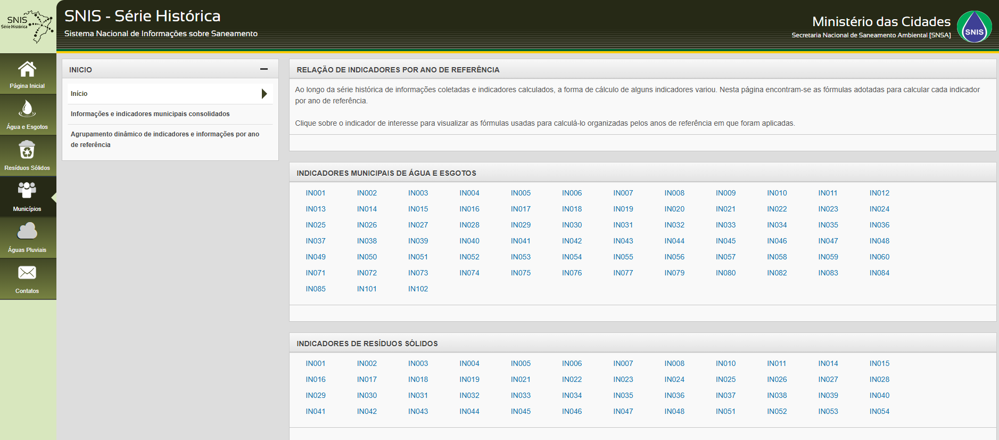

IN015
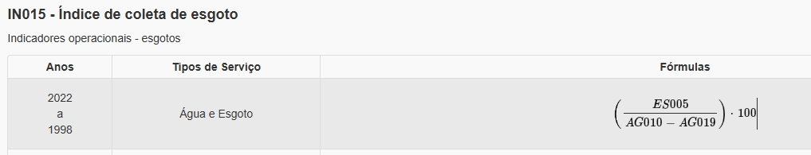
Este será utilizado e é composto pela seguinte fórmula:
(ES005 / AG010 - AG019) * 100
sendo:

AG010 - Volume de água consumido (1.000 m3/ano)	
AG019 - Volume de água tratada exportado (1.000 m3/ano)		
ES005 - Volume de esgotos coletado (1.000 m3/ano)	
IN015 - Índice de coleta de esgoto (%)

Validar qual indicador utilizar
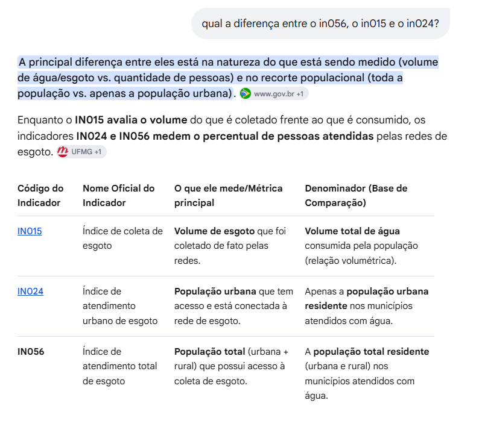

Sanemaneto basico x coleta de esgoto
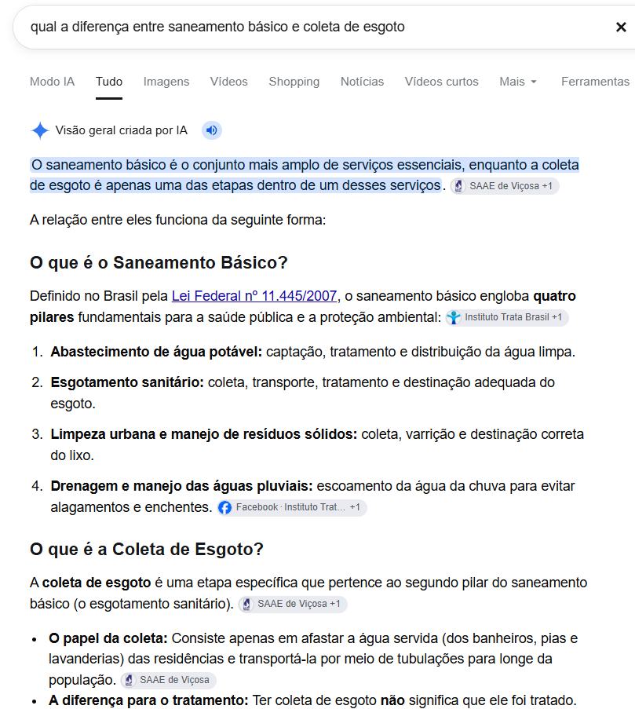

Foram verificados 2 registros em branco e 4 com 0 (indicador IN015)
Foi identificado que os registros em branco corrrespondiam 
Foi identificado qeu os regisros em branco e os registros 0 foram ocasionados pela mesma situação
Ou o cálculo do indice ficou igual a 0, ou o calculo ficou negativo (caso em que a cidade exportava mais agua do que consumia)
Foi convencionado que em todos esses casos, assumiríamos o valor do índice como 0.

IN016
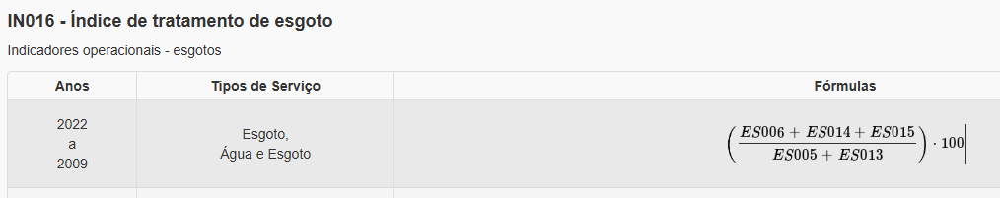

IN046
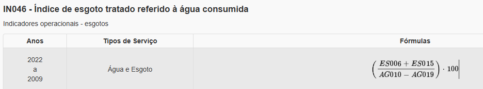

Obsoleto - Para elaboração do relatorios (extração dos dados), foram utilizados os seguintes filtros
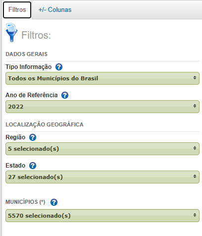

Obsoleto - E as seguintes colunas:
Obsoleto - Famílias de informações e indicadores
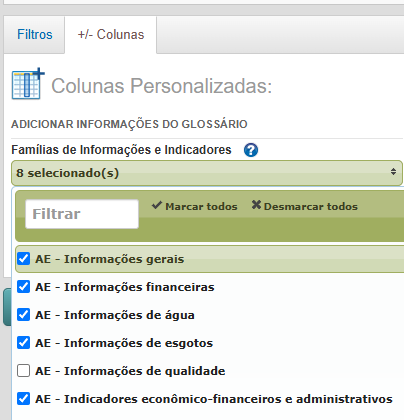
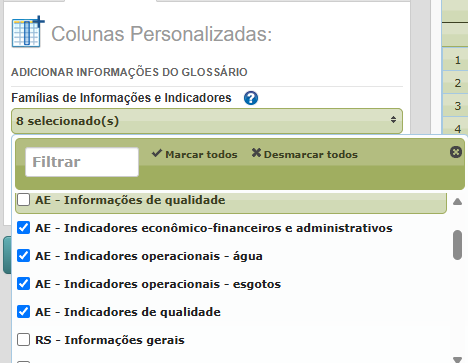
Obsoleto - Informações e Indicadores = todos
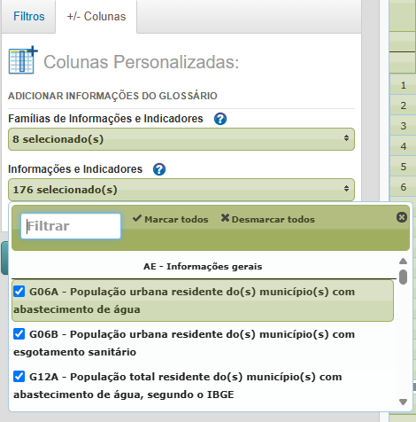

Filtro 1
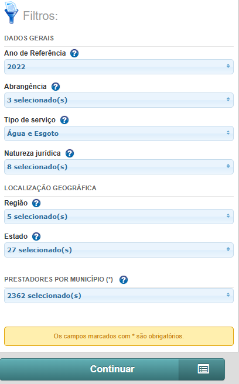

Ano de referencia: 2022
Foram gerados alguns filtros.
Gerado o arquivo ConsolidadeMunicipio-202610144214416
Verificado que haviam 2 códigos de municipio (codigo ibge e codigo de muncipio)
Ao verificar os dados de mortalidade, verificado que ele utiliza o código do mounicipio.
utilizado este.
https://app4.cidades.gov.br/serieHistorica/#

Utilizada a listagem de municipios da taebela d eesgoto, pois possuía codigo ibge, codigo municipio e estado.
Carregados os arquivos no Power BI para organizar os dados e fazer ETL.
Craido o arquivo Analise_Esgoto_MortalidadeInf_2022
ok-Ajsutadas as tabelas fato (F_) e dimensão (D_)
ok-Ajsutados relacionaemtnos.
se esgoto está em branco = 0
Criação dos indicadores
pegar os dados de origem do esgoto?

